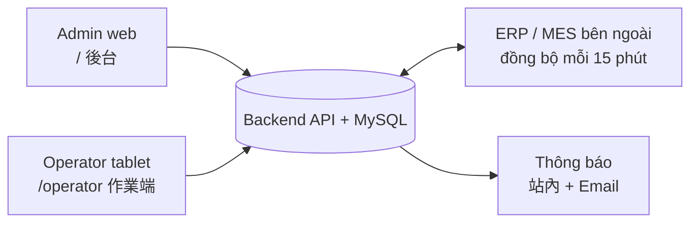

# 01 · Tổng quan hệ thống

## Kiến trúc

| | Admin (後台) | Operator (作業端) |
|---|---|---|
| Người dùng | Quản lý, kỹ sư, QA, PC (生管) | Công nhân tại máy |
| Đăng nhập | Tài khoản + mật khẩu, cần quyền `backend:access` | Session thiết bị + **工號** cho từng thao tác |
| Thiết bị | PC | Máy tính bảng + máy quét mã vạch / camera |
| Mục đích | Dữ liệu gốc, xử lý ngoại lệ, truy vết | Báo công, đổi trạng thái máy |

## 13 menu Admin

| Nhóm | Menu | Route | Chức năng chính |
|---|---|---|---|
| — | 首頁 | `/` | 4 KPI (TK, 工序, 設備 đang bật / tổng, 工藝路線) + bảng trạng thái toàn bộ máy |
| Quyền | 帳號管理 | `/accounts` | 帳號, 顯示名稱, 員工編號 (=工號), Email, 角色, 密碼 ≥ 8 |
| Quyền | 角色管理 | `/roles` | Gán 19 quyền cho vai trò |
| Dữ liệu gốc | 工序主檔 | `/operations` | Mã, tên, có cần máy, hạng mục QC |
| Dữ liệu gốc | 瑕疵代碼 | `/defect-codes` | Mã lỗi; gắn với 工序 |
| Dữ liệu gốc | 設備管理 | `/equipments` | 編輯, 設定可執行工序, 設定設備狀態, QR, 查看紀錄 |
| Dữ liệu gốc | 工藝路線管理 | `/process-routes` | Tuyến + version (`/{id}/versions/{vid}/edit`) |
| Sản xuất | RunCard 管理 | `/run-cards` | Tạo, import, mọi thao tác theo trạng thái |
| Sản xuất | 工作紀錄 | `/work-records` | Mỗi lần 上工→下工 = 1 dòng |
| Truy vết | 稽核日誌 | `/audit-logs` | Thời gian, hành động, người, RunCard, trạng thái từ→đến, lý do |
| Truy vết | 設備狀態歷程 | `/equipments/status-history` | Lịch sử trạng thái máy, thời lượng |
| Cấu hình | 通知規則設定 | `/notification-rules` | 11 sự kiện |
| Cấu hình | MES 同步 | `/mes-sync` | Đồng bộ tự động 15', chạy tay từ thời điểm X, lịch sử + chi tiết |

## Danh sách RunCard (Admin)

Cột: RunCard 編號 · 工單編號 · 品號 · 品名 · 狀態 · 數量（目前/原始）· 累計報廢 · 累計重工 · 累計拆批 · 累計瑕疵 · 建立時間 · 更新時間 · 操作

Bộ lọc:
- Text: RunCard 編號, 工單編號, 品號, 品名
- 狀態: 待上工, 進行中, 品質保留, 已完成, 異常, 已報廢, 已取消, 已轉單
- 來源類型: 一般建立, 重工, 拆批, 瑕疵單
- 資料來源: MES 同步, 系統建立
- Checkbox: 僅顯示待關聯, 僅顯示同步不完全

## 工作紀錄 (work record)

Cột: RunCard, 工單, 設備, 作業員, 工序範圍, 投入→產出, 報廢, 報廢原因, 品質結果, 瑕疵數量, 瑕疵代碼 (xem), 上工時間, 下工時間, 完工狀態, 生產註記.

## Đánh số thẻ

| Loại | Mẫu | Ví dụ |
|---|---|---|
| Thẻ thường | Do người dùng nhập | `DEMO-RC-0002` |
| Thẻ tách lô | `{gốc}-NN` | `DEMO-RC-0002-01` |
| Thẻ lỗi | `{gốc}-DN` | `DEMO-RC-0001-D1` |
| Thẻ rework | `R` + YYMM + số thứ tự | `R26115004` |
