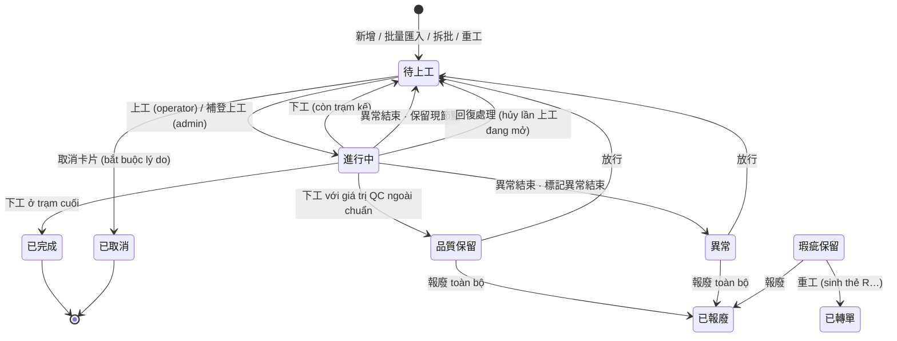

# 02 · Máy trạng thái RunCard



`瑕疵保留` là trạng thái khởi đầu của thẻ lỗi `-D1`, được tạo tự động khi 下工 có số lượng thiếu.

## Thao tác theo trạng thái

| Trạng thái | Admin | Operator (quét thẻ) |
|---|---|---|
| 待上工 | 重工 · 拆批 · 臨時工序 · 回復處理¹ · 補登 · 編輯 · 取消卡片 | 上工 · 臨時工序 · 跳站 |
| 進行中 | 回復處理 · 補登 (下工) | 下工 · 異常結束 |
| 品質保留 | 放行 · 報廢 · 重工 · 回復處理 | — |
| 異常 | 放行 · 報廢 · 重工 · 回復處理 | — ("此狀態目前沒有可執行的操作") |
| 瑕疵保留 | 報廢 · 重工 | — |
| 已完成 / 已轉單 / 已取消 / 已報廢 | chỉ xem | chỉ xem |

¹ Chỉ khi thẻ đã có ít nhất 1 工作紀錄. Mọi trạng thái đều có 詳情 · 查看工作紀錄 · 列印.

## Đẳng thức số lượng

```
目前數量 + 累計報廢 + 累計重工 + 累計拆批 + 累計瑕疵 = 原始數量
```

Ví dụ đã kiểm: `DEMO-RC-0002` gốc 50, tách 20 → `30 + 0 + 0 + 20 + 0 = 50`.

## Vị trí trên tuyến

- RunCard giữ `current_node` (trạm hiện tại) trên một phiên bản tuyến cố định lúc tạo.
- Màn hình operator hiển thị tiến trình: `▶` trạm hiện tại, `○` trạm chưa làm, `⚠ ×n` số lần 異常結束 tại trạm.
- 臨時工序 không đổi `current_node`; làm xong quay về tuyến.
- 跳站 bỏ qua trạm, cần ủy quyền.
- Thẻ **免路線** (E 單 – đơn thí nghiệm): không gắn tuyến, qua trạm tùy ý; không đổi được sau khi tạo.
