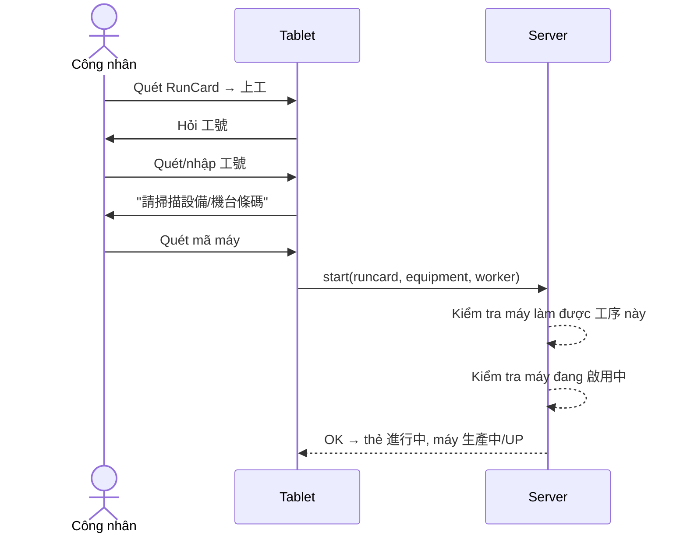

# 03 · Luồng trên máy tính bảng (作業端)

Màn hình chính chỉ có **một ô quét**: nhận RunCard hoặc mã thiết bị (MES code). Có nút 📷 相機掃描. Mỗi thao tác ghi dữ liệu đều mở hộp **工號登入** (chỉ nhập mã nhân viên, không mật khẩu).

## Quét RunCard

Hiển thị: 工單, 品號, 品名, 狀態, 待執行工序, 工藝路線, 目前數量 (x / gốc), tiến trình trạm, 佔用設備 (nếu đang chạy).

### 上工

- Không hỏi số lượng đầu vào khi 上工 (đầu vào = số lượng hiện tại).
- Máy không làm được công đoạn này → "此設備無法執行該工序".
- Máy 維修中 / 未開機 → "設備目前不是啟用中（維修中 / 未開機等），請先將設備狀態切回啟用中再上工".
- 工序 không cần máy → "請掃描現場工序條碼" (quét/nhập mã công đoạn).

### 下工 (wizard)

1. **產出數量** – số lượng đạt.
2. **瑕疵代碼** – chỉ khi thiếu so với đầu vào; bắt buộc phân bổ phần thiếu cho mã lỗi; chỉ hiện mã gắn với 工序. Tạo thẻ lỗi `-D1`.
3. **QC 項目** – nếu 工序 có cấu hình. Cho nhập ngoài chuẩn, nhưng thẻ sẽ thành 品質保留.
4. **生產註記** – tùy chọn.
5. **確認** – phải cuộn hết trang mới bật nút 完成下工.

Kết quả: thẻ sang trạm kế (待上工) hoặc 已完成 ở trạm cuối; máy về 機台閒置 (US_4).

Có thể vào 下工 bằng cách quét mã máy; nếu máy có nhiều thẻ → "選擇要下工的 RunCard".

### 異常結束

Chỉ hiện khi thẻ 進行中. 工號 → chọn 卡片去向:

| Lựa chọn | Kết quả thẻ | Kết quả máy |
|---|---|---|
| 保留現節點（可重新上工） | 待上工 tại cùng trạm, ⚠ +1 | 機台閒置 US_4 |
| 標記異常結束 | 異常 (operator bị khóa, admin xử lý) | 機台閒置 US_4 |

Cả hai bắt buộc 原因. 標記異常結束 bắn thông báo "RunCard 異常".

### 臨時工序

Chọn 工序 + 原因 (bắt buộc). Làm xong quay về trạm cũ.

### 跳站

Hộp "跳站授權": nhập **tài khoản + mật khẩu Admin** của người có quyền `work_records:skip_node`, chỉ dùng cho lần này.

## Quét mã thiết bị

Hiển thị: tên, MES code, 狀態, 狀態原因; nếu đang chạy: 進行中的卡 + thông tin thẻ.

Nút: `下工 {RunCard}` (khi đang chạy) · `設定設備狀態` · `返回掃描`.

### 設定設備狀態

| Tình trạng máy | Wizard | Lựa chọn |
|---|---|---|
| Trống (không có thẻ) | 3 bước: 目標狀態 → 原因 → 備註 | 啟用中 / 維修中 / 未開機 + mã lý do tương ứng |
| Đang có thẻ (生產中) | 2 bước: 原因 → 備註 | Chỉ UP · US_2 · US_5 (không có 維修中) |

**Hệ quả:** máy hỏng giữa chừng phải 異常結束 (保留現節點) trước rồi mới chuyển 維修中 được.
