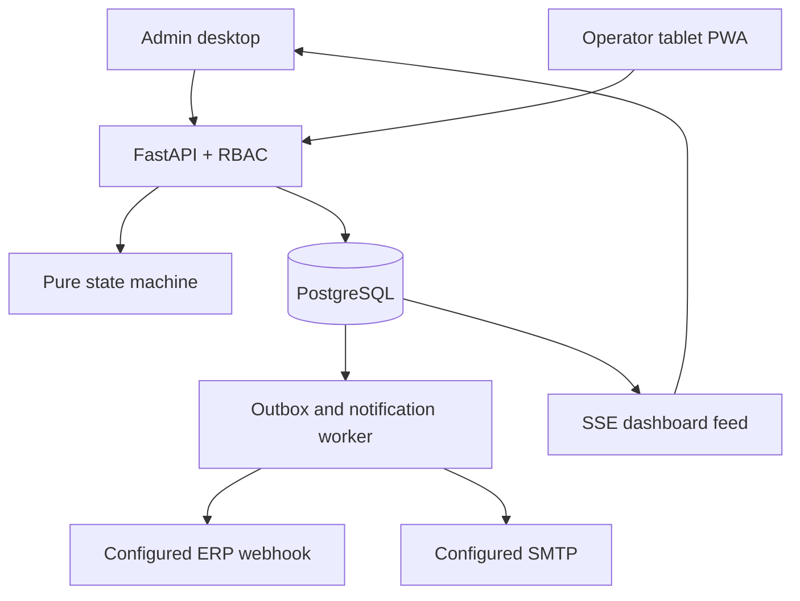

# Implementation architecture

FastAPI + psycopg is used so the supplied PostgreSQL schema remains the source of truth. React/Vite/TypeScript serves `/admin` and `/operator` from one bundle; operator has an installable PWA shell. Business decisions live in a pure Python state machine and are persisted by a transactional service. Decimal arithmetic is used throughout quantities and QC.

## Repository layout

- `backend/app/domain.py`: immutable transition decisions and validation, BR-01…24.
- `backend/app/service.py`: one transaction per command, snapshots, audit, outbox, idempotency.
- `backend/app/main.py`: typed command endpoints, authentication, admin reads/configuration, SSE.
- `backend/app/worker.py`: retryable external delivery and repeat/escalation notifications.
- `backend/tests`: business rules and real PostgreSQL integration tests.
- `frontend/src`: bilingual operator and admin applications.
- `db/schema.sql`, `db/seed_demo.sql`: original specification, unchanged.
- `db/002_runtime.sql`: additive runtime migration, constraints, sessions, movement ledger.
- `docs/implementation/openapi.json`: generated API contract.
- `compose.yaml`: database, API, worker, frontend with same-origin reverse proxy.

## Confirmed decisions (2026-11-09)

The user approved extending BR-01 for OPT-04:

`current + scrap + rework + split + defect + returned + transferred = original`.

Cancellation records an explicit disposition (scrap, return, transfer), immutable movement, and outbox event. Transfer creates a linked successor card at the same route node; it does not silently inflate an existing card's original quantity.

For release, the user selected both modes. `release_reason_required` defaults to true (BR-24); an admin may configure optional mode, matching document 04. Policy changes are audited.

QC failure retains the node where QC failed; release returns to WAITING at that same node (BR-08). Route-free work returns to WAITING until explicitly finished during checkout. Temporary work returns to its original node, including when it occurs at the route's last node.

Equipment may host several cards, as document 03 permits. BR-19 is preserved literally: closing a card creates US_4 history even if another card remains open. Occupancy is derived from open work records, not the reason code. A breakdown atomically closes **all** open cards on that equipment before entering maintenance.

## Consistency and security

All business mutations serialize under a PostgreSQL transaction advisory lock for this initial deployment, then validate `run_cards.version`. This conservative strategy prevents multi-card/equipment lock-order deadlocks; replace with ordered per-aggregate locks after load measurement. Every mutation creates audit/outbox records in the same transaction. Idempotency keys are actor-scoped, payload-bound, and replay the committed response. Reusing a key for different input returns 409. Stale versions return 409, requiring review rather than silent retry.

Admin sessions require password login; operator sessions require a provisioned device token plus an active employee number. Employee sessions expire after five minutes; disabling session reuse forces the next write to identify the employee again. Server checks apply even when frontend controls are hidden. Temporary skip authorization consumes a short-lived, card-bound supervisor token once.

The PWA caches static assets only. Production writes require a live API; offline action queues (P3 OPT-13) are intentionally deferred to avoid misrepresenting queued work as committed.
